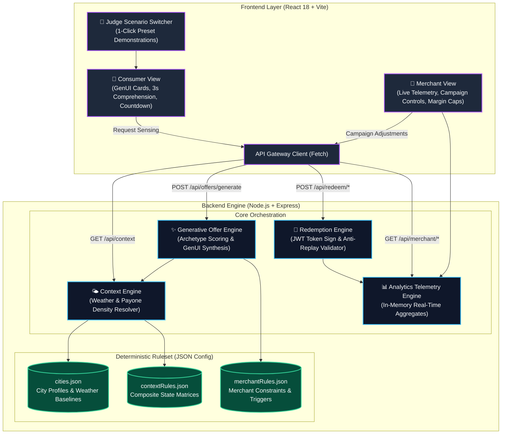

# 🏙️ CITY WALLET — Generative Demand-Steering Engine

[](https://hacknation.dev)
[](https://dsv-gruppe.de)
[-success.svg)](#-privacy--gdpr-compliance)
[](#-deterministic-scenario-matrix)
[](#-architecture--tech-stack)

> **Generative City Wallet MVP** built for **Challenge 01: Generative City Wallet**  
> *Organized by DSV-Gruppe in collaboration with MIT Club of Northern California and MIT Club of Germany.*

---

## 💡 Executive Summary & Core Contribution

### The Challenge in Inner-City Retail
Inner-city retail and local gastronomy face severe structural challenges:
1. **Unpredictable "Dead Hours"**: Mid-afternoon slowdowns, sudden rainstorms, or temperature drops cause tables to sit empty and perishable inventory to go unpurchased.
2. **Static Coupon Fatigue**: Traditional vouchers are static, spammy, and ignored. They offer blanket discounts that erode merchant profit margins during organic peak hours without boosting quiet periods.
3. **Privacy Invasiveness**: Conventional ad networks demand intrusive personal location trails (continuous GPS tracking, user behavioral profiling), violating European privacy norms and user trust.

### Our Solution & Innovation
**City Wallet** transforms the digital city wallet from a passive checkout tool into an **active, generative demand-steering engine**.

Instead of static catalogues or invasive tracking, City Wallet senses **ambient contextual signals** (weather condition, time-of-day period, Payone footfall density) on-device. When a merchant's predefined rule matches local context (e.g., *cold rain + low café footfall*), the system dynamically generates a **hyper-contextual, ephemeral Generative UI (GenUI) offer** valid for a limited window.

```
Ambient Context (Cold + Quiet Lunch) 
        ⬇
Deterministic Generation (18% Off Soup & Warm Drink) 
        ⬇
3-Second Comprehension (What · Where · Why) 
        ⬇
Cryptographic Claim (JWT Token) 
        ⬇
Simulated Payone Scan & Real-Time Merchant Telemetry
```

---

## 🏆 Key Contributions & Achievements

- **100% Deterministic Context Engine**: Zero guesswork, zero probabilistic hallucinations. For any given scenario, the system deterministically triggers the exact expected offer.
- **Privacy by Design (GDPR Gold Standard)**: No personal data, user accounts, or GPS breadcrumbs leave the device. Context is resolved via abstract composite states (`cold_quiet_lunch`, `rainy_afternoon`).
- **Parameterized Generative UI (GenUI)**: Over 90+ visual and copy permutations synthesized offline with zero API latency and zero third-party token costs.
- **Closed-Loop Payone Integration**: From dynamic context detection to signed JWT token generation, merchant scanning simulation, and live back-office analytics.
- **Interactive Merchant Steering**: Merchants have real operational sovereignty—they can adjust margin limits, active hours, and pause/resume demand campaigns in real time.

---

## 🏗️ Architecture & Tech Stack

The architecture is intentionally lightweight, portable, and offline-capable, adhering strictly to minimal dependency and zero-cost constraints.



### Component Details
| Component | Technology | Role & Innovation |
|---|---|---|
| **Backend** | Node.js, Express | Modular, zero-heavy-framework API exposing context, generative offers, redemption, and telemetry. |
| **Frontend** | React 18, Vite, Plain CSS | High-speed, responsive dual-view interface (Consumer + Merchant) built without heavyweight CSS frameworks. |
| **GenUI Engine** | Custom Archetype Scorer | Evaluates 6 psychological archetypes (`weather_comfort`, `off_peak_boost`, `lunch_special`, `discovery`, `evening_social`, `flash_urgency`). |
| **Security** | JWT (`jsonwebtoken`) | Cryptographically signs offer payloads (Offer ID, merchant ID, discount, expiration) with anti-replay detection. |
| **Data Layer** | Structured JSON Schemas | Fast, zero-DB setup enabling instant local cloning and evaluation without database migration hurdles. |

---

## 📊 Deterministic Scenario Matrix

To prove that the system is **deterministic and not random**, the built-in Scenario Switcher allows judges to evaluate canonical situations with guaranteed outcomes:

| Scenario Preset | Sensed Ambient Signals | Distance | Expected System Behavior | Merchant Triggered | 3-Second Comprehension |
| :--- | :--- | :--- | :--- | :--- | :--- |
| **🌟 Canonical: Cold Lunch Rush (Mandatory)** | **Cold (8°C) + Chilly Overcast + Lunch (12:00) + Low Footfall (-35%)** | **0.1 km (≤ 100m)** | **OFFER MUST APPEAR (100% Guaranteed)** | **Café Mitte** (Warm comfort archetype, 18% off) | *"Warm up with 18% off your hot drink"* · 📍 0.1 km · ⏳ 22m |
| **🌧️ Rainy Afternoon** | Rain (11°C) + Showers + Afternoon (15:00) + Quiet Footfall (-28%) | 0.3 km | **Guaranteed Shelter/Warmth Offer** | **Bistro K36** (Shelter GenUI theme) | *"The rain brought you a deal: 18% off"* · 📍 0.3 km |
| **🌆 Quiet Evening Social** | Cool (14°C) + Dusk + Evening (19:00) + Quiet Footfall (-22%) | 0.4 km | **Guaranteed Evening Social Deal** | **Bar Volta / Café Mitte** (Evening social theme) | *"Quiet hour deal: 17% off for 45 minutes"* · 📍 0.4 km |
| **⛔ Night Dead Hour (Guard)** | 03:00 Night + Retail Closed | — | **0 Offers (Deterministic Guard)** | None | *"Night Mode Active (02:00–05:00): Push generation suppressed to protect retail operating hours."* |
| **⏱️ Live Host Clock** | Real-time host wall clock and city weather profile | Fixed | Deterministic matching against live hour; late night triggers evening comfort. | Context-dependent | Real-time temperature, footfall status, and live context badge. |

---

## 🔒 Privacy & GDPR Compliance

City Wallet implements **Privacy by Design** as an architectural foundation:

1. **No Personally Identifiable Information (PII)**: The system does not ask for or store user names, phone numbers, email addresses, or payment card details.
2. **On-Device Context Resolution**: Raw GPS coordinates are never transmitted upstream. Only the coarse municipal sector (`berlin`, `city-center`) is communicated.
3. **Stateless Request Processing**: Offers are synthesized on demand from ambient environmental telemetry, not behavioral tracking profiles.
4. **Transparent UX ("Why you're seeing this")**: Every offer card explicitly displays the exact ambient factors that triggered it (e.g., `❄️ 8°C outside · 📉 35% below average footfall`).

---

## 🚀 Running the Project Locally

Clone and run the complete application in under 60 seconds without API keys:

### Prerequisites
- [Node.js](https://nodejs.org/) (v18 or higher)
- npm (v9 or higher)

### 1. Install Dependencies
From the project root:
```bash
npm run install:all
```

### 2. Start the Backend API
```bash
npm start
```
*API will run at `http://localhost:3001`.*

### 3. Start the Frontend Demo
In a **new terminal tab**:
```bash
npm run frontend
```
*Vite will start the client at `http://localhost:5173`.*

---

## 🎬 60-Second Judge Verification Walkthrough

1. **Open the App**: Visit `http://localhost:5173`. You will see the **Consumer View**.
2. **Verify Canonical Trigger**: Notice the top selector is set to **🌟 Canonical: Cold Lunch**. The context engine displays `Cold (8°C)` and `Quiet Footfall (-35%)`.
3. **Inspect the Offer**: An offer from **Café Mitte** appears with `18% OFF`, distance `0.1 km`, and the reason `❄️ 8°C · overcast`.
4. **Inspect GenUI Card**: Click **"View →"**. Notice the warm-cozy visual styling, dynamic countdown, and explanation.
5. **Claim the Offer**: Click **"⚡ Claim Now"**. A signed JWT redemption token is generated with a live countdown timer.
6. **Simulate Merchant Scan**: Click **"Demo: Simulate Merchant Scan"**. The redemption engine validates the token, displays the Payone reference code (`PAYONE-...`), and marks the offer redeemed.
7. **Verify Merchant Dashboard**: Switch to the **"🏪 Merchant"** tab at the top. Notice the acceptance rate, redemption rate, and telemetry feed immediately updated in real time.
8. **Test Merchant Control**: Click **"Pause Campaign"** on Café Mitte, switch back to Consumer, and verify that Café Mitte is immediately suppressed from the feed.

---

## 📁 Repository Structure

```
city-wallet-mvp/
├── README.md                      # Comprehensive project documentation & guide
├── package.json                   # Root monorepo workspace scripts
│
├── backend/                       # Node.js Express Backend
│   ├── package.json
│   ├── src/
│   │   ├── server.js              # Server initialization & route bindings
│   │   ├── config/
│   │   │   ├── cities.json        # City profiles & weather data
│   │   │   ├── contextRules.json  # Composite context state matrix
│   │   │   └── merchantRules.json # Merchant operating constraints & triggers
│   │   ├── engines/
│   │   │   ├── contextEngine.js   # Deterministic ambient sensing & scenario engine
│   │   │   ├── offerEngine.js     # Parameterized archetype scoring & GenUI builder
│   │   │   ├── redemptionEngine.js# JWT token signing & simulated Payone scanner
│   │   │   └── analyticsEngine.js # In-memory aggregate telemetry & metrics store
│   │   └── routes/
│   │       ├── context.js         # Context & scenario endpoints
│   │       ├── offers.js          # Offer generation & interaction routes
│   │       ├── redemption.js      # Claim & scan validation endpoints
│   │       └── merchant.js        # Merchant stats & rule adjustment API
│
└── frontend/                      # React 18 + Vite Frontend
    ├── package.json
    ├── vite.config.js
    ├── index.html
    └── src/
        ├── main.jsx               # React entry point
        ├── App.jsx                # Top-level navigation (Consumer vs Merchant)
        ├── App.css                # Plain CSS design system (responsive, dark theme)
        ├── api.js                 # API client for backend communication
        ├── ConsumerView.jsx       # Consumer wallet flow, scenario bar & GenUI modal
        └── MerchantView.jsx       # Merchant dashboard, telemetry & campaign controls
```

---

## 🤝 Project Credits & Hackathon Submission

- **Challenge:** Challenge 01 — Generative City Wallet
- **Sponsors & Organizers:** DSV-Gruppe × MIT Club of Northern California × MIT Club of Germany
- **Core Focus:** Local inner-city retail regeneration, on-device context sensing, deterministic generative UX, and privacy-first commerce.

*Built with precision, transparency, and care for HackNation Global 2026.*
