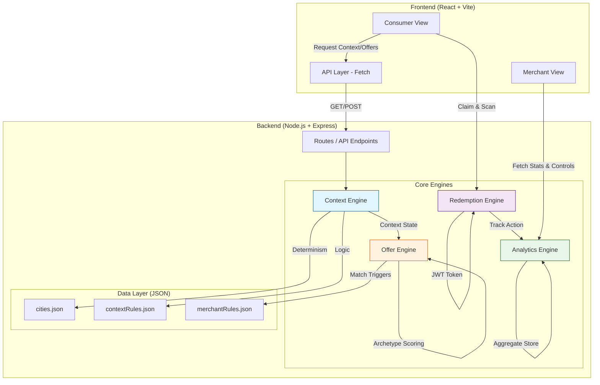

# CITY WALLET 🏙️✨

**Generative City Wallet MVP** — built for the *HackNation Global Hackathon (DSV-Gruppe × MIT Clubs)*.

An AI-powered, real-time city wallet that detects user context, dynamically generates hyper-personalized local offers, and redeems them through a simulated checkout flow.

## 🎯 What We Built & Why It Matters
Inner-city retail struggles with dead hours and unpredictable weather. Traditional static coupons are easily ignored. 

**City Wallet** solves this by generating **hyper-contextual, ephemeral offers** that reach the user exactly when they make sense. 
- ❄️ *Cold Tuesday + Quiet Café?* The system generates a "Warm Up with 18% off" offer.
- 📉 *Low transaction volume detected?* A flash deal appears to boost off-peak traffic.

**For DSV-Gruppe & Payone**, this transforms the wallet from a passive payment tool into an **active demand-generation engine**, driving footfall to local merchants while deeply respecting user privacy.

## 🏗️ Architecture & Tech Stack

This MVP is purposefully built to be lightweight, deterministic, and highly stable for demonstrations without relying on paid external APIs or complex build tools.



### Tech Stack
- **Backend**: Node.js + Express
- **Frontend**: React + Vite
- **Styling**: Plain CSS (No Tailwind or PostCSS dependencies)
- **Data**: JSON configuration files (No external database required)
- **Security**: JWT (JSON Web Tokens) for simulated secure redemption flow
- **AI/Logic**: Parameterized, offline deterministic generation engine (Zero API cost, zero latency)

### 📊 Deterministic Scenario Matrix

| Scenario Preset | Sensed Context Signals | Distance | Expected System Behavior | Triggered Merchant |
| :--- | :--- | :--- | :--- | :--- |
| **🌟 Canonical: Cold Lunch** | Cold (8°C) + Lunchtime (12:00) + Low Demand (-35%) | **0.1 km (≤ 100m)** | **Offer MUST appear (100% deterministic)** | **Café Mitte** (Warm comfort archetype, 18% off) |
| **🌧️ Rainy Afternoon** | Rain (11°C) + Afternoon (15:00) + Quiet (-28%) | 0.3 km | Guaranteed shelter/warmth offer | **Bistro K36** (Shelter GenUI theme) |
| **🌆 Quiet Evening** | Cool (14°C) + Evening (19:00) + Quiet (-22%) | 0.4 km | Guaranteed evening social deal | **Bar Volta** (Evening social theme) |
| **⛔ Night Dead Hour** | 03:00 Night + Retail closed | - | **0 Offers (Deterministic Guard)** | None (Prevents late-night push spam) |

### 1. Context Sensing Layer (On-Device / Offline Simulation)
Aggregates real-time signals without tracking user identity or relying on external paid APIs:
- **Weather**: Deterministic city-seeded weather model (e.g. Berlin is naturally colder in April).
- **Time of Day**: Classified dynamically.
- **Location**: Simulated based on city selection.
- **Demand**: Simulated Payone transaction density curves (detects "quiet" vs "busy" hours).
- *Output*: A "Composite Context State" (e.g., `cold_quiet_lunch`).

### 2. Generative Offer Engine
NO static offers. 
When a context state triggers a merchant's rules, the parameterized offline generation engine creates an offer on the fly:
- **Copy Text**: Emotional/Factual copy tailored to the weather/time.
- **Dynamic Discount**: Dynamically set within the merchant's min/max limits.
- **Visual Style (GenUI)**: Changes colors/themes based on context (e.g., amber for warm themes, blue for rain).
- **Distance**: Each offer displays a simulated proximity to the merchant (e.g., "0.3 km").

#### How the AI Scoring Works (No LLM Required)
The engine maintains 6 offer **archetypes** (e.g., `weather_comfort`, `off_peak_boost`, `flash_urgency`). When a request arrives, each archetype is scored against the live context using **weather affinity**, **demand affinity**, **time-of-day affinity**, and the **merchant's preferred archetypes**. The highest-scoring archetype is selected. Its headline and body templates are then filled with context-specific variables (temperature, discount %, expiry time, product). The discount itself is dynamically computed within the merchant's min/max range based on demand level and composite state priority. This produces **90+ unique offer permutations** without calling any external API — making it fully offline, deterministic, and zero-latency.

### 3. Redemption Flow & Merchant Dashboard
- **Consumer View**: Shows "Why you're seeing this", countdown timers, and generates a redemption token.
- **Simulated Scan**: "Simulate Merchant Scan" validates the token and shows a cashback/success receipt (simulating Payone).
- **Merchant View**: A live dashboard showing generated offers, acceptance rates, and active AI rules without exposing any PII.

## 🔒 Privacy by Design (GDPR Stance)
- **No PII Tracking**: Precise GPS data is never sent. Only the general city zone is used.
- **Abstract Signals**: The engine only sees abstract states (`rainy`, `quiet_lunch`), never user history.
- **Transparent UX**: Every offer explicitly shows *why* it was generated (e.g., "❄️ 4°C outside").

## 🚀 Running the Project Locally

No complicated setup, no API keys needed. Just run these commands from the root directory:

1. Install dependencies for both backend and frontend:
```bash
npm run install:all
```

2. Start the backend:
```bash
npm start
```

3. Open a **new terminal** and start the frontend demo:
```bash
npm run frontend
```

4. Open `http://localhost:5173` in your browser.

## 🎬 Demo Scenario to Try (Mia in Stuttgart / Berlin)
1. Open the UI. You are on the **Consumer** tab.
2. The app detects the current "Context" (e.g., Morning + Cold).
3. If the context matches a merchant rule, an offer slides in. Notice the text clearly mentions the weather or time!
4. Tap **View →** to open the GenUI card. Note the dynamic discount and 3-second comprehension design.
5. Tap **Claim Now**. You'll see a redemption token and a countdown.
6. Tap **Demo: Simulate Merchant Scan** to simulate the Payone validation flow.
7. Switch to the **Merchant** tab at the top. See how the acceptance and redemption rates updated instantly in real-time!

---

*Suggested Git Commit Messages:*
- `feat: initialize monolithic workspace for city wallet MVP`
- `feat(backend): implement deterministic context sensing engine`
- `feat(backend): add offline parameterized generative offer engine`
- `feat(backend): create JWT-based simulated payone redemption engine`
- `feat(frontend): build consumer and merchant react views with plain CSS`
- `docs: add comprehensive README with architecture and demo steps`
